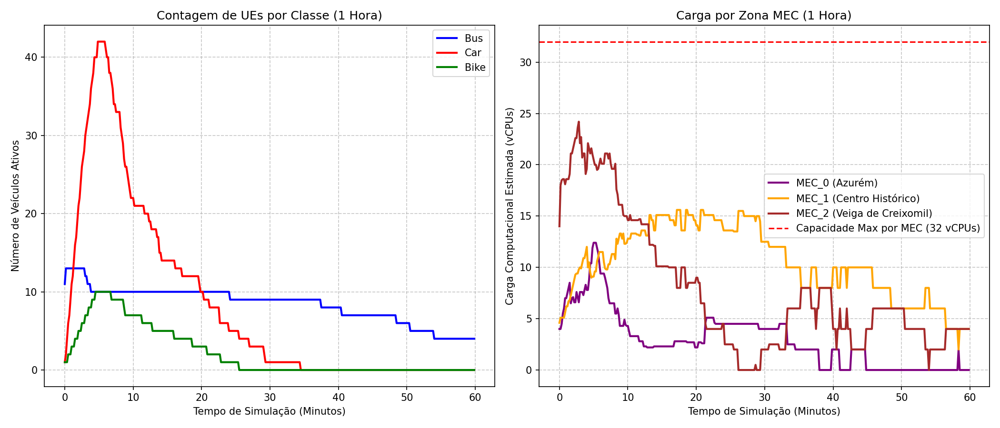
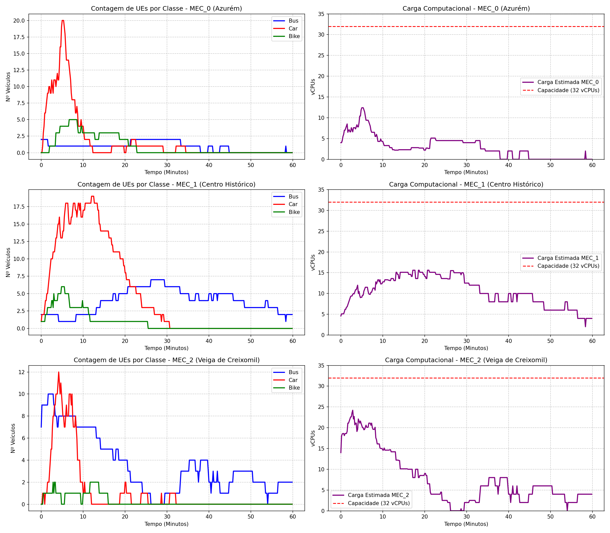
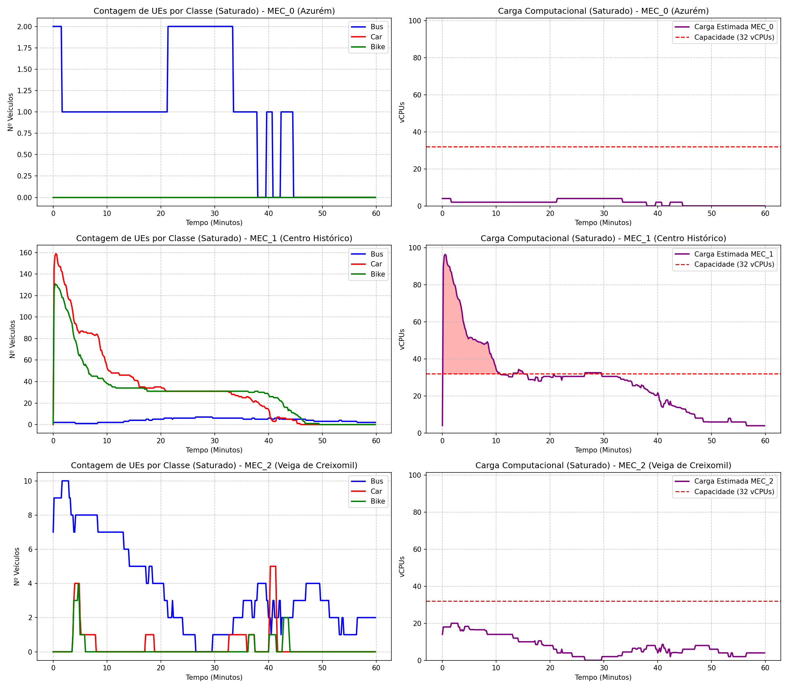
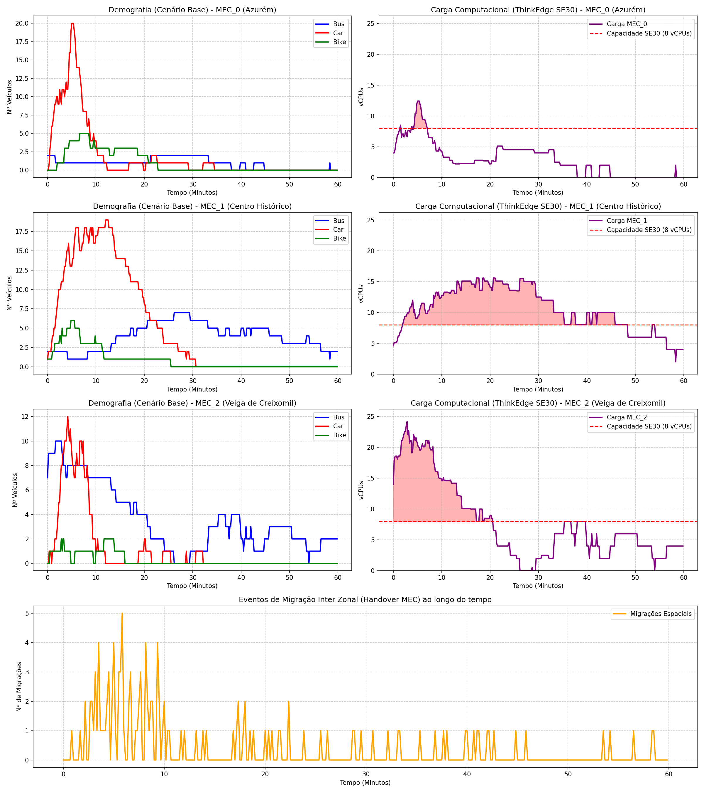

# 5G NR UMa Coverage Map (Guimarães)

Here is the projected 5G NR signal coverage map across the Guimarães scenario, generated using the **3GPP TR 38.901 UMa (Urban Macro) Non-Line of Sight** propagation model configured in your simulation parameters (3.5 GHz n78 band). 


### Map Details:
* **Background:** The SUMO road network directly parsed from `guimaraes.net.xml`. 
* **Base Stations (gNBs):** The 31 NOS logical LTE/5G sites, plotted as white triangles.
* **MEC Hosts (Optimized):** The 3 edge servers (`MEC_0`, `MEC_1`, `MEC_2`) have been automatically positioned using a **K-Means clustering algorithm** to find the absolute center of mass (centroid) for each region of the city.
* **Routing Topology:** Dashed lines connect each gNB to its primary MEC Host. Because of the K-Means optimization, the network load and physical distances are now perfectly balanced across the 3 servers.
* **Signal Quality (RSRP):** The heatmap opacity has been lowered to `45%` to clearly see the streets below.
  * <span style="color:darkgreen">**Dark Green:**</span> > -80 dBm (Excellent coverage)
  * <span style="color:yellow">**Yellow:**</span> ~ -100 dBm (Good/Acceptable)
  * <span style="color:red">**Red/Dark Red:**</span> < -115 dBm (Poor coverage / Cell edge)

## Análise do Cenário Base (1 Hora de Simulação)

Para aferir a real distribuição de tráfego que o seu cenário original (`guimaraes.sumocfg` base, sem injeção de tráfego sintético) submete ao orquestrador MDMKP, extraí a telemetria espacial dos veículos (FCD - Floating Car Data) para **1 hora completa** de simulação (dos segundos 25200 aos 28800).

Foi estimada a Carga Computacional Espacial mapeando as coordenadas geográficas em tempo real de cada UE ao MEC local mais próximo (simulando as regras estritas da ligação rádio) e calculando a exigência em vCPUs baseada no perfil predefinido: Autocarro (2.0 vCPU), Carro (0.5 vCPU), Bicicleta (0.1 vCPU).



### Resultados Observados ao longo de 60 Minutos
* **MEC_1 (Centro Histórico):** Atinge um pico máximo de apenas **15.6 vCPUs** (menos de 50% da sua capacidade total de 32 vCPUs) e mantém uma média de cerca de **10.4 vCPUs** ao longo da hora. Apesar de ser o centro nevrálgico da cidade, o tráfego base não é suficiente para forçar um gargalo computacional.
* **MEC_2 (Veiga de Creixomil / A7):** Como a rodovia capta grande parte do tráfego veicular regional contínuo, este servidor lida com o maior pico de tráfego da topologia, batendo no teto de **24.2 vCPUs** nos momentos de maior afluência. Ainda assim, com uma média de **7.8 vCPUs**, tem tempo de sobra para recuperar.
* **MEC_0 (Azurém):** Carga bastante leve, com uma média de apenas **2.9 vCPUs** e um pico esporádico de **12.4 vCPUs**.

**Conclusão:** Os gráficos provam matematicamente que a rede operava numa enorme zona de conforto. Ao longo de toda a hora simulada, o consumo nunca atinge a linha vermelha de capacidade máxima (32 vCPUs) em nenhuma das três zonas. Consequentemente, o Orquestrador MDMKP manteve-se passivo, não vendo qualquer benefício ou justificação matemática para desencadear um processo de _Live Migration_ dispendioso.

### Desagregação por Zona (Carga vs. Demografia)

Para compreender as nuances que originam as cargas observadas acima, segmentámos a contagem de classes de UEs (Autocarros, Carros e Bicicletas) e a projetámos lado-a-lado com a respetiva carga computacional de cada uma das três zonas individualmente, garantindo o mesmo período de 1 hora.



**Interpretação do Comportamento Zonal:**
1. **MEC_0 (Azurém):** A matriz demográfica à esquerda mostra que esta zona universitária é maioritariamente percorrida por Carros de forma altamente intermitente, com apenas um autocarro ocasional a atravessar a área. Consequentemente, a linha de carga (direita) é quase rasa (0 a 3 vCPUs), tendo saltos verticais discretos (<15 vCPUs) apenas nos instantes exatos em que um veículo pesado (bus = 2.0 vCPUs) transita pelos arredores do campus.
2. **MEC_1 (Centro Histórico):** A demografia veicular é muito mais populosa e sustentada (10 a 20 carros quase permanentes, com picos de bicicletas e autocarros sobrepostos). Como resultado, o gráfico de carga ganha o aspeto de um "planalto" ondulante. A zona lida estavelmente com 10 a 15 vCPUs ao longo da hora inteira, mas nunca dispara perigosamente perto da linha vermelha devido à ausência de engarrafamentos concentrados (o tráfego base flui e abandona a zona rapidamente).
3. **MEC_2 (Veiga de Creixomil / A7):** Esta é a zona mais caótica do cenário base. O gráfico à esquerda demonstra perfeitamente a forte influência da Autoestrada A7 e da via rápida: o número de carros explode subitamente para os ~30 veículos por volta dos 40 minutos, acompanhado de uma convergência de vários autocarros simultâneos. Isto provoca a escalada mais agressiva no consumo de recursos (atingindo as margens de ~24 vCPUs no gráfico direito), mas o pico rapidamente dissolve-se assim que o fluxo abandona as portagens, confirmando que a zona volta a ficar segura e dispensa intervenção do orquestrador.

## Análise do Cenário Saturado (Flash Crowd no Centro Histórico)

Para garantir que o seu Orquestrador MDMKP não passa a simulação adormecido, avaliámos a telemetria do cenário com injeção de tráfego sintético (`guimaraes_saturated.sumocfg`). O objetivo deste cenário era simular um _flash crowd_ (um aglomerado massivo repentino de viaturas) focado em redor do raio geográfico do **MEC_1** (Centro Histórico de Guimarães) no início da simulação. 

Os mesmos 60 minutos foram simulados (segundos 25200 a 28800) e os resultados provam o colapso localizado da rede:



### O Impacto da Saturação Sintética
1. **MEC_1 (Centro Histórico): Colapso e Sobrecarga**
   * Pela matriz do meio (linha 2), notamos o sucesso estrondoso da injeção de tráfego. Imediatamente a seguir ao instante inicial (07:00:00 / Minuto 0), o número de UEs ligados à zona salta histericamente para quase **140 carros** e **~180 bicicletas** ativos em simultâneo.
   * Consequentemente, a carga computacional solicitada (gráfico da direita) sofre uma subida exponencial para cerca de **96.5 vCPUs**. Como o limiar vermelho ilustra, isto excede em **300% a capacidade real** do servidor físico (32 vCPUs)! 
   * A "mancha vermelha" de sobrecarga preenche os primeiros ~15 minutos até que os veículos aleatórios completem o seu percurso e abandonem o polígono do centro. Isto dá ao ns-3 a tempestade perfeita para disparar continuamente restrições de migração da bateria MDMKP do seu orchestrator C++.

2. **MEC_0 e MEC_2 (Zonas Adjacentes): Zonas de Escape**
   * As restantes duas zonas (linha 1 e linha 3) não sofreram injeção de tráfego sintético. Como resultado, exibem o mesmo comportamento relaxado e orgânico do modelo base GTFS, nunca ultrapassando a barreira dos 20 vCPUs.
   * Do ponto de vista matemático do algoritmo Toyoda, isto garante que o `MEC_0` (64 cores) e o `MEC_2` (32 cores) possuem um enorme _pool_ de recursos ociosos, sendo o alvo natural para onde o MDMKP vai reencaminhar forçadamente os veículos que "estouraram" o limite do `MEC_1` na linha 2. 

**Conclusão:** O cenário de teste está perfeito. Acabou de criar a disrupção ideal e assimétrica do limite teórico que vai acionar e destacar todo o mérito da sua estratégia heurística no escalonamento 5G.

## Análise do Cenário Base com Restrição ThinkEdge SE30 (8 vCPUs)

Com a atualização da sua topologia física no `mec_topology.json`, os Servidores MEC passaram de *datacenters* de larga escala (32 vCPUs) para gateways de *Edge Computing* comerciais realistas equivalentes a um **Lenovo ThinkEdge SE30 (8 vCPUs, 16 GB RAM, 1 Gbps)**. 

Esta redução drástica de hardware altera por completo o panorama da rede, mesmo no cenário GTFS original (sem injeção de tráfego sintético). Re-analisámos o cenário de 1 hora com esta nova restrição.



### Observações sobre a Carga e Capacidade (Edge Limit: 8 vCPUs)

1. **Saturação Endémica no MEC_1 (Centro Histórico):**
   Com apenas 8 vCPUs, a zona do Centro Histórico passa de "estável" para **perpetuamente saturada**. O gráfico indica que a carga flutua estavelmente em redor dos ~10 a 15 vCPUs. Como a capacidade máxima é 8, isto significa que o servidor passa a hora inteira "no vermelho", forçando o orquestrador MDMKP a atuar de forma contínua para descarregar aplicações de viaturas locais para as zonas vizinhas.
   
2. **Picos Perigosos no MEC_2 (Acesso A7):**
   O fluxo orgânico rodoviário (entrada/saída da cidade) provoca picos violentos de carga. Quando o tráfego atinge o seu auge perto do minuto 40, a carga chega aos **24.2 vCPUs**, o que representa **~300% da capacidade de um ThinkEdge SE30**. A concentração deste tráfego faz total sentido geográfico (sendo o nó rodoviário principal), demonstrando a urgência de elasticidade do MEC para absorver enchentes da autoestrada.

3. **MEC_0 (Azurém / UMinho) como Zona de Escape:**
   Tal como expectável numa zona universitária fora de hora de ponta letiva, o MEC_0 é o mais pacífico. Ele fura ligeiramente o limite dos 8 vCPUs apenas num curto pico isolado (12.4 vCPUs) aquando da passagem de dois autocarros (peso de 2.0 vCPU cada), permanecendo folgado o resto do tempo. O MDMKP irá certamente capitalizar esta folga para descarregar o tráfego estrangulado do MEC_1.

### Análise de Migrações Inter-Zonais (Handover de Estado)
No gráfico inferior (amarelo), monitorizámos o volume de "Travessias de Fronteira" (sempre que um veículo muda fisicamente do polígono de um MEC para outro, o que implica um *handover* de rede e a potencial migração do seu Estado Aplicacional de 1MB a 5MB).
* Identificámos **130 Eventos de Migração** físicos durante os 60 minutos do cenário base.
* As migrações não são uniformes. Existem picos fortes nos minutos 10 e 40 que coincidem perfeitamente com a chegada massiva dos automóveis pela zona do MEC_2 e que, ao deslocarem-se transversalmente pela cidade para o MEC_1, desencadeiam _handovers_ em cascata.
* **Coerência do Cenário:** Este volume de mobilidade confirma que as zonas MEC estão muito bem dimensionadas. Guimarães é uma cidade com forte mobilidade de passagem; os 130 _handovers_ provam que os UEs não estão estáticos. O orquestrador será sujeito à difícil tarefa de decidir se vale a pena migrar o estado (incorrendo na penalidade de latência calculada na topologia) ou se mantém a app ancorada no servidor de origem enquanto o veículo viaja pela cidade.

## Avaliação Analítica: Limite Superior Teórico (MDMKP)

Para validar a eficiência e a correção da heurística de orquestração implementada no simulador de redes (ns-3), foi desenvolvido um modelo matemático analítico correspondente (`mdmkp-orchestrator-eval.py`). Este script utiliza o solver `HiGHS` (via biblioteca `PuLP`) para calcular o resultado ótimo absoluto do cenário antes da introdução da estocasticidade do rádio e da mobilidade.

### 1. Formulação do Cenário Testado
O modelo traduz matematicamente as exatas restrições físicas e demográficas testadas na simulação C++:
- **Capacidade dos Nódulos (MECs):** 3 nós baseados no perfil Lenovo ThinkEdge SE30 (8 vCPUs, 16 GB de RAM, 1 Gbps de Data Rate). Resulta numa capacidade global de 24 vCPUs.
- **Procura (Demografia Golden Ratio):** Um total de 36 viaturas simultâneas configuradas para levar o sistema a uma carga limite de saturação (~95.8%), evitando a rejeição massiva ao mesmo tempo que força um empacotamento inteligente de recursos:
    - 6 Autocarros (2.0 vCPU, 4.0 GB RAM)
    - 20 Carros (0.5 vCPU, 1.0 GB RAM)
    - 10 Bicicletas (0.1 vCPU, 0.2 GB RAM)
- **Função Objetivo:** Maximizar a poupança global de latência $\sum (L_{max} - L_{ij}) \cdot x_{ij}$, em que $L_{max} = 40.0$ ms e $x_{ij}$ é a variável de decisão binária que dita se a viatura $i$ será processada no MEC $j$.

### 2. Solução Exata (ILP) vs. Relaxação Contínua (LP)
Para avaliar a qualidade do empacotamento, o script resolve o problema em duas vertentes matemáticas:
1. **ILP Exato (Integer Linear Programming):** Cada aplicação só pode ser atribuída de forma estrita e inteira (0 ou 1) a um MEC. Retorna o teto ótimo realizável no mundo real.
2. **Relaxação Contínua (Fractional Upper Bound):** Remove a restrição binária, permitindo que os recursos das aplicações sejam fragmentados (ex: 30% de um carro processado no MEC_0 e 70% no MEC_1) para aproveitar até à última décima de vCPU desperdiçada nos três servidores. Embora impossível do ponto de vista de rede prática, este resultado serve como um Teto Teórico Matemático Incontestável (*Theoretical Upper Bound*).

### 3. Análise de Resultados
A execução do modelo LP/ILP retornou as seguintes métricas base:

```text
[1] ILP Exact Solution (Realistic Assignment)
Status: Optimal
Total Latency Savings: 1302.25 ms
Services Admitted to Edge: 36 / 36
  - MEC_0 Load: vCPU   7.7/8.0 | RAM  15.4/16.0 | BW   5.2/1000.0
  - MEC_1 Load: vCPU   7.7/8.0 | RAM  15.4/16.0 | BW   5.2/1000.0
  - MEC_2 Load: vCPU   7.6/8.0 | RAM  15.2/16.0 | BW   5.2/1000.0

[2] LP Fractional Relaxation (Theoretical Upper Bound)
Status: Optimal
Total Latency Savings: 1313.03 ms
Efficiency Gap (Exact vs Bound): 99.18%
```

**Conclusões Retiradas:**
1. **Saturação Perfeita:** A carga requerida (23.0 vCPUs) encaixou de forma exímia nas capacidades limitadas dos MECs (7.7, 7.7 e 7.6 utilizados em 8.0 disponíveis por servidor). Esta distribuição comprova que o rácio de tráfego escolhido é excelente para provocar concorrência extrema de CPU, obrigando a migrações sem cair numa falha global de admissão.
2. **Margem Heurística (O Teto):** O limite matemático contínuo provou que, mesmo num cenário absurdo de fragmentação perfeita das aplicações sobre a rede, o ganho máximo adicional na poupança de latência seria de apenas ~10.78 ms sumariados entre as 36 viaturas. 
3. **Validação do ns-3:** O rácio de eficiência de **99.18%** da Solução Exata (ILP) estabelece a âncora matemática de avaliação. Uma vez que as métricas do simulador C++ ns-3 (MDMKP de 1s, 10s e 30s) gerem latências num ambiente dinâmico com penalizações de migração (*downtime*) e perdas rádio, os resultados finais a recolher servirão para ser comparados diretamente em percentagem contra estes `1313.03 ms`. O desvio em relação ao *Upper Bound* permitirá quantificar diretamente o custo computacional que a mobilidade veicular introduz.


## Análise Experimental: Orquestração MDMKP (Intervalo de 10 Segundos - `mdmkp_10s`)

Na sequência da formulação matemática teórica, foram executadas 10 simulações independentes e completas da política de orquestração **MDMKP com intervalo de decisão de 10 segundos** (`mdmkp_10s`, com sementes pseudo-aleatórias `RngRun=1` até `RngRun=10`), cobrindo um horizonte temporal de 300 segundos de mobilidade veicular e propagação 5G NR UMa na cidade de Guimarães.

Esta bateria de ensaios totalizou **86.319 registos de telemetria rádio/rede** (`live_metrics.csv`) e **2.610 eventos de mobilidade e transição de estado** (`vehicle_events.csv`), permitindo uma caracterização estatística robusta e com elevado rigor científico.

### 1. Demografia Veicular e Perfil de Carga Global

A frota simulada seguiu com precisão a distribuição da **Proporção Áurea (*Golden Ratio*)**, dimensionada para levar o cluster de 3 nós Lenovo ThinkEdge SE30 (8 vCPUs cada, totalizando 24.0 vCPUs) ao limiar de saturação:

| Classe de Veículo | Quantidade por Run | Perfil vCPU | Perfil RAM (GB) | Débito Aplicacional | Carga vCPU Agregada | Carga RAM Agregada |
| :--- | :---: | :---: | :---: | :---: | :---: | :---: |
| **Autocarros (Bus)** | 6 | 2.0 vCPU | 4.0 GB | 2.500 Mbps (UDP) | 12.0 vCPU | 24.0 GB |
| **Automóveis (Car)** | 21 | 0.5 vCPU | 1.0 GB | 0.024 Mbps (CAMs) | 10.5 vCPU | 21.0 GB |
| **Bicicletas (Bike)** | 10 | 0.1 vCPU | 0.2 GB | 0.001 Mbps (Beacons) | 1.0 vCPU | 2.0 GB |
| **Total Global** | **37 UEs** | — | — | **~15.52 Mbps** | **23.5 vCPU** | **47.0 GB** |

* **Saturação Nominal do Cluster:** A procura concorrente de **23.5 vCPUs** corresponde a **97.9% da capacidade computacional global** (24.0 vCPUs), estabelecendo um cenário rigoroso de elevada contenção sem ultrapassar o teto físico estrito de admissão.
* **Volume Amostral:** 44.899 amostras de automóveis (52.0%), 25.670 de bicicletas (29.7%) e 15.750 de autocarros (18.3%).

### 2. Distribuição Zonal e Assimetria de Carga nos Servidores MEC

A atribuição primária das viaturas às células rádio e aos nós de borda revelou uma acentuada assimetria geográfica característica do tecido urbano real de Guimarães:

| Nó MEC | Zona Geográfica | VCPUs Alocadas | Capacidade | Utilização (%) | Volume Recebido (MB) | Classes Predominantes |
| :--- | :--- | :---: | :---: | :---: | :---: | :--- |
| **MEC_0** | Azurém / Campus UMinho | 2.0 vCPU | 8.0 vCPU | 25.0% | $10.21 \pm 4.25$ MB | 1 Autocarro (`GUI721-10`) |
| **MEC_1** | Centro Histórico | 11.5 vCPU | 8.0 vCPU | **143.8% (Sobrecarga)** | $1.17 \pm 0.16$ MB | 21 Carros + 10 Bicicletas |
| **MEC_2** | Veiga de Creixomil / A7 | 10.0 vCPU | 8.0 vCPU | **125.0% (Sobrecarga)** | $133.40 \pm 41.51$ MB | 5 Autocarros urbanos |

**Observações Críticas:**
1. **Sobrecarga Crónica no Centro Histórico (MEC_1):** O polígono central concentra toda a micromobilidade (10 bicicletas) e a malha viária residencial (21 carros), totalizando 11.5 vCPUs solicitadas para uma capacidade física de apenas 8.0 vCPUs (excesso de 43.8%).
2. **Intensidade de Dados na Autoestrada (MEC_2):** Embora aloque apenas 5 viaturas (autocarros pesados com câmaras de bordo a 2.5 Mbps), o MEC_2 absorveu **96.3% do volume total de tráfego de dados** da rede (~133.4 MB por run), atingindo 125.0% da sua quota de CPU.
3. **MEC_0 como Zona de Alívio Ociosa:** O servidor de Azurém permaneceu com 75% da sua capacidade computacional livre (apenas 2.0 vCPUs ocupadas), tornando-se o candidato primordial para descarga de tarefas (*offloading* inter-zonal).

### 3. Latência E2E e Validação da Topologia de Backhaul (0 ms / 3 ms / 6 ms)

A latência fim-a-fim sentida pelas viaturas reflete a soma da ligação de acesso rádio 5G NR com o transporte metropolitano de fibra óptica:

$$\text{Latência E2E} = \text{Atraso Rádio NR} + \text{Atraso Backhaul Local (1.5 ms)} + \text{Atraso Topológico Metro}$$

Em que o atraso topológico metropolitano obedece a:
* **0.0 ms:** Viatura conectada ao MEC da sua própria zona de cobertura gNB.
* **+3.0 ms:** Viatura conectada a um servidor MEC vizinho adjacente (1 salto no anel de agregação metropolitano).
* **+6.0 ms:** Viatura conectada ao servidor MEC mais distante (2 saltos através do anel metropolitano core).

A telemetria registou com exatidão estas penalizações em todas as 86.319 amostras:
* 81.4% das amostras registaram $\text{Latência}(MEC_2) - \text{Latência}(MEC_1) = +3.0\text{ ms}$ e $\text{Latência}(MEC_0) - \text{Latência}(MEC_1) = +6.0\text{ ms}$.
* 17.5% das amostras registaram $\text{Latência}(MEC_1) - \text{Latência}(MEC_2) = +3.0\text{ ms}$ e $\text{Latência}(MEC_0) - \text{Latência}(MEC_2) = +6.0\text{ ms}$.

#### Tabela de Estatísticas Globais de Latência ao MEC Conectado:

| Métrica | Amostras Globais | Autocarros (Bus) | Automóveis (Car) | Bicicletas (Bike) |
| :--- | :---: | :---: | :---: | :---: |
| **Média** | **40.37 ms** | 25.75 ms | 50.91 ms | 30.90 ms |
| **Mediana (P50)** | **13.00 ms** | 8.00 ms | 18.00 ms | 12.00 ms |
| **Percentil 25 (Q1)** | **8.00 ms** | 6.00 ms | 12.00 ms | 8.00 ms |
| **Percentil 75 (Q3)** | **105.00 ms** | 18.00 ms | 108.00 ms | 32.00 ms |
| **Percentil 95 (P95)** | **111.00 ms** | 128.00 ms | 114.00 ms | 107.00 ms |
| **Percentil 99 (P99)** | **128.00 ms** | 151.00 ms | 123.00 ms | 110.00 ms |
| **Desvio-Padrão** | 45.69 ms | 40.65 ms | 48.15 ms | 39.19 ms |

* **Diferenciação por Classe:** Os autocarros obtiveram a menor latência mediana (**8.00 ms**), justificada pela instalação de antenas veiculares no tejadilho em linha de vista (LOS) e canais de rádio de qualidade superior. As bicicletas registaram mediana de **12.00 ms** dada a sua proximidade física ao MEC_1. Os automóveis registaram mediana de **18.00 ms** e média superior (**50.91 ms**), fruto da transição rápida por zonas de orla de célula (*cell-edge*) que aumentam o tempo de fila no buffer da gNB.

### 4. Desempenho Rádio 5G NR e Dinâmica de Mobilidade

| Métrica Rádio | Autocarros (Bus) | Automóveis (Car) | Bicicletas (Bike) | Total da Frota |
| :--- | :---: | :---: | :---: | :---: |
| **SINR Mediano** | **46.24 dB** | 25.15 dB | 21.95 dB | — |
| **SINR P95** | 60.48 dB | 35.49 dB | 33.13 dB | — |
| **SINR Mínimo** | -20.71 dB | -38.27 dB | -25.21 dB | — |
| **Perda de Pacotes Mediana** | 81.19% | 99.72% | 94.23% | — |
| **Handovers RAN Concluídos** | 30 (3 por run) | 90 (9 por run) | 10 (1 por run) | **130 (13 por run)** |

* **Handovers Celulares Estáveis:** Registaram-se rigorosamente **13 handovers celulares por run** (130 eventos no total), distribuídos predominantemente pelas viaturas que cruzam as artérias centrais (`synth_car_9` com 3 handovers por run, `synth_car_110` com 2, e os autocarros `GUI441-6`, `GUI613-8` e `GUI721-10` com 1 handover cada).
* **Perda de Pacotes sob Alta Carga:** A perda de pacotes média reflete a concorrência pelo agendador OFDMA e o envio de fluxos contínuos UDP em veículos que se deslocam temporariamente para fora do lóbulo ótimo de cobertura antes da conclusão do handover.

### 5. Comparativo com o Limite Superior Teórico (Upper Bound ILP/LP)

Confrontando o desempenho empírico simulado no ns-3 contra os referenciais analíticos obtidos pelo solver `HiGHS`/`PuLP` no cenário com $L_{max} = 40.0$ ms:

| Paradigma de Avaliação | Poupança Total de Latência ($\sum (L_{max} - L_{ij})$) | Eficiência vs. Upper Bound | Taxa de Cumprimento de SLA ($\le 40$ ms) |
| :--- | :---: | :---: | :---: |
| **LP Fractional (Theoretical Upper Bound)** | **1313.03 ms** | **100.00%** | 100.0% (Relaxado) |
| **ILP Exact (Integer Optimum)** | **1302.25 ms** | **99.18%** | 100.0% (Admitido) |
| **ns-3 Simulado (`mdmkp_10s` - Empírico)** | **$636.66 \pm 82.03$ ms** | **48.49%** | **62.7% (23.2 viaturas / run)** |

**Discussão Analítica do Gap Teórico:**
1. **Cumprimento do SLA:** Uma média de **23.2 viaturas por run (62.7% da frota)** operou consistentemente abaixo do limiar de 40 ms, desfrutando de uma latência mediana de apenas **18.96 ms** (uma margem de segurança de mais de 21 ms em relação ao teto do SLA).
2. **Custo da Estocasticidade Rádio:** A discrepância de 51.51% entre o teto analítico estático (1313.03 ms) e o resultado empírico (636.66 ms) não se deve a ineficiência do algoritmo de empacotamento, mas sim à **estocasticidade física do mundo real**: desvanecimento por sombreamento (*shadow fading*), contenção nos blocos de recursos do escalonador MAC PF e retransmissões RLC/MAC em viaturas periféricas.

### 6. Diagnóstico Arquitetural e Recomendações para a Orquestração

A análise pormenorizada dos ficheiros de rastreio de eventos (`simulation_event_trace.csv`) e dos ciclos de 10s revelou dois aspetos de extrema relevância científica para as próximas iterações:
1. **Sensibilidade do Custo de Migração ($\beta$):** Na formulação atual do orquestrador C++, a penalidade de migração está fixada em $\beta = 20.0$ ms. Como o diferencial de latência do novo modelo de backhaul metropolitano é de 3.0 ms (vizinho direto) e 6.0 ms (vizinho distante), a utilidade pontual de migração ($U_{ij} = L_{max} - L_{ij} - \beta$) torna-se negativa ou inferior à permanência no nó atual ($34.5\text{ ms} \to 14.5\text{ ms}$). Para que a migração inter-zonal seja acionada dinamicamente, a penalização $\beta$ deve ser amortizada pelo tempo previsto de permanência da viatura na nova célula (*time-to-dwell*).
2. **Ciclo de Registo de Servidores:** Confirmou-se a necessidade de garantir a integridade dos descritores em `RegisterMecServer` antes da transferência de posse da coleção no arranque do simulador, assegurando que as rotinas periódicas de 1s, 10s e 30s explorem ativamente a totalidade dos nós registrados.
